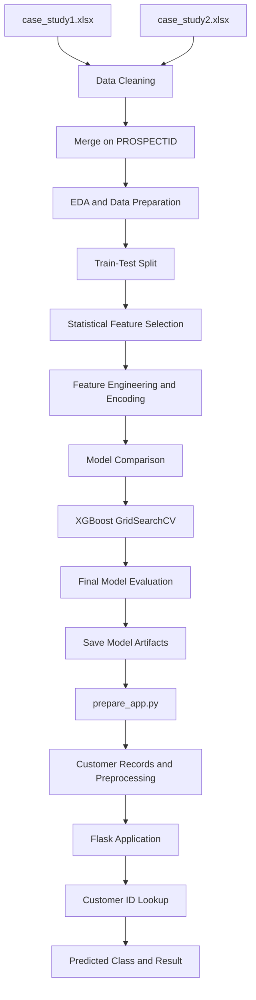

# 🏦 Credit Priority Intelligence System
### End-to-End Machine Learning Classification & Flask Application

An end-to-end machine learning project that analyses banking customer data and classifies customer records into four target categories (P1, P2, P3 and P4). The project covers data preparation, statistical feature selection, model development, evaluation and local application deployment using Flask.

<p align="center">

**📊 Data Analytics | 🤖 Machine Learning | 🌐 Flask Deployment**

</p>

| Project Detail | Description |
|---|---|
| 🏢 Domain | Banking / FinTech |
| 🎯 Project Type | Supervised Machine Learning – Multiclass Classification |
| 🏷️ Target Variable | `Approved_Flag` |
| 🆔 Identifier | `PROSPECTID` |
| 🛠️ Application | Flask |
| 🔒 Institution | Anonymised |

---

## 📑 Table of Contents

1. [🎯 Project Overview](#1--project-overview)
2. [💼 Business Understanding](#2--business-understanding)
3. [🚀 Project Objectives](#3--project-objectives)
4. [🛠️ Technology Stack](#4--technology-stack)
5. [📂 Dataset Overview](#5--dataset-overview)
6. [🔄 End-to-End Workflow](#6--end-to-end-workflow)
7. [🧹 Data Preparation and EDA](#7--data-preparation-and-eda)
8. [📊 Statistical Feature Selection](#8--statistical-feature-selection)
9. [⚙️ Feature Engineering and Preprocessing](#9--feature-engineering-and-preprocessing)
10. [🤖 Model Development](#10--model-development)
11. [📈 Model Evaluation](#11--model-evaluation)
12. [🌐 Flask Application](#12--flask-application)
13. [🏗️ Project Architecture](#13--project-architecture)
14. [📁 Repository Structure](#14--repository-structure)
15. [💻 Installation and Setup](#15--installation-and-setup)
16. [▶️ Running the Application](#16--running-the-application)
17. [📦 Model Artifacts](#17--model-artifacts)
18. [💡 Key Learnings](#18--key-learnings)
19. [🚧 Limitations and Future Improvements](#19--limitations-and-future-improvements)
20. [🙌 Acknowledgements](#20--acknowledgements)

---

## 1. 🎯 Project Overview

The **Credit Priority Intelligence System** is an end-to-end machine learning project built using an anonymised Indian banking customer dataset.

The objective is to develop a multiclass classification model that learns patterns from customer-related attributes and predicts one of four target categories: P1, P2, P3 or P4.

The project goes beyond model development by integrating the trained model into a Flask web application. A user can enter a customer ID (`PROSPECTID`) and retrieve a model-generated classification through a simple interface.

### ✨ Project Highlights

- 🧹 Data cleaning and integration.
- 🔍 Exploratory Data Analysis (EDA).
- 📊 Statistical feature selection.
- ⚙️ Feature engineering and categorical encoding.
- 🤖 Decision Tree, Random Forest and XGBoost model comparison.
- 🎛️ XGBoost hyperparameter tuning.
- 📈 Model evaluation.
- 📦 Model serialization using Pickle.
- 🌐 Local Flask application development.

## 2. 💼 Business Understanding

Financial institutions work with large volumes of customer information across multiple banking and credit-related attributes.

Analysing these attributes can help identify patterns and support customer classification workflows.

This project explores how machine learning can be used to classify customer records into predefined categories based on historical data.

### 🎯 Business Use Case

A user should be able to:

1. Identify a customer using their unique customer identifier.
2. Retrieve the corresponding customer record.
3. Apply the same preprocessing logic used during model development.
4. Generate a predicted classification.
5. View the result through a simple web interface.

> ⚠️ **Important:** The P1–P4 categories are treated as the dataset's predefined target labels. Their exact business definitions and ordering are not assumed. The model output is an analytical prediction, not an automated loan approval, rejection or credit decision.

## 3. 🚀 Project Objectives

- Integrate two related banking datasets using a common customer identifier.
- Handle sentinel values and improve data quality.
- Explore customer attributes and target-class distribution.
- Identify relevant categorical and numerical features using statistical techniques.
- Reduce multicollinearity among numerical predictors.
- Build and compare multiple classification algorithms.
- Tune the selected model using cross-validation.
- Evaluate multiclass classification performance.
- Save the trained model and preprocessing-related artifacts.
- Develop a Flask interface for customer-ID-based prediction.

## 4. 🛠️ Technology Stack

| Category | Technologies |
|---|---|
| 💻 Programming Language | Python |
| 📊 Data Manipulation | Pandas, NumPy |
| 📈 Data Visualisation | Matplotlib, Seaborn |
| 📐 Statistical Analysis | SciPy, Statsmodels |
| 🔍 Feature Selection | Chi-Square, ANOVA, VIF |
| 🤖 Machine Learning | Scikit-learn |
| 🚀 Gradient Boosting | XGBoost |
| 📋 Model Evaluation | Accuracy, Precision, Recall, F1-score, Confusion Matrix |
| 📦 Model Serialization | Pickle |
| 🌐 Application Backend | Flask |
| 🎨 Frontend | HTML, CSS |
| 🧪 Development Environment | Jupyter Notebook, VS Code |
| 🔗 Version Control | Git, GitHub |

## 5. 📂 Dataset Overview

The project uses two Excel datasets:

- `case_study1.xlsx`
- `case_study2.xlsx`

Both datasets contain related customer information and are integrated using the common identifier `PROSPECTID`.

### 🏷️ Target Variable

`Approved_Flag`

The target contains four classes:

- P1
- P2
- P3
- P4

### 🆔 Identifier

`PROSPECTID` is used to identify and retrieve customer records. It is excluded from the model's predictive features.

The dataset contains numerical and categorical customer attributes.

The original data files are used as model-development inputs. The institution identity is intentionally kept anonymised.

## 6. 🔄 End-to-End Workflow

The project follows this sequence:

1. 📥 Load the two Excel datasets.
2. 🧹 Clean invalid and sentinel values.
3. 🔗 Merge datasets using `PROSPECTID`.
4. 🔍 Perform exploratory data analysis.
5. 🎯 Separate independent variables and target.
6. ✂️ Split the data into training and testing sets.
7. 📊 Perform statistical feature selection.
8. ⚙️ Encode categorical variables and handle missing values.
9. 🤖 Train and compare classification models.
10. 🎛️ Tune XGBoost hyperparameters.
11. 📈 Evaluate the final model.
12. 📦 Save model artifacts.
13. 🔧 Prepare customer lookup data and preprocessing configuration.
14. 🌐 Run the Flask application.
15. ✅ Generate customer-ID-based predictions.

## 7. 🧹 Data Preparation and EDA

### 7.1 🔗 Dataset Integration

The two Excel datasets are merged using an inner join on `PROSPECTID`.

The merge uses one-to-one validation to check the expected relationship between the two datasets.

### 7.2 🧹 Handling Sentinel Values

The dataset uses `-99999` as a sentinel value.

The cleaning process follows these rules:

- Remove records from the first dataset where `Age_Oldest_TL` contains `-99999`.
- Identify columns in the second dataset containing more than 10,000 sentinel values and remove those columns.
- Remove records containing sentinel values in the remaining columns of the second dataset.

### 7.3 🔍 Exploratory Data Analysis

EDA is performed to understand:

- Dataset structure and dimensions.
- Target-class distribution.
- Categorical columns.
- Data quality and potential issues.

The target distribution is visualised to understand the representation of the four classes.

## 8. 📊 Statistical Feature Selection

Feature selection is an important part of this project because the original dataset contains multiple customer attributes.

Three statistical techniques are used.

### 8.1 Chi-Square Test

**Purpose:** Identify categorical features that have a statistically significant association with the target variable.

The test is applied to selected categorical candidates:

- `MARITALSTATUS`
- `EDUCATION`
- `GENDER`
- `last_prod_enq2`
- `first_prod_enq2`

A significance threshold of **p-value ≤ 0.05** is used for feature retention.

### 8.2 Variance Inflation Factor (VIF)

**Purpose:** Identify and reduce multicollinearity among numerical predictors.

The VIF calculation is performed iteratively:

1. Calculate VIF for numerical candidate features.
2. Identify the feature with the highest VIF.
3. Remove the feature with the highest VIF if the threshold is exceeded.
4. Repeat until the retained features satisfy the specified threshold.

**VIF retention threshold: ≤ 6**

### 8.3 ANOVA (Analysis of Variance)

**Purpose:** Identify numerical features that show statistically significant differences across the four target classes.

The numerical features retained after VIF screening are evaluated using one-way ANOVA.

A significance threshold of **p-value ≤ 0.05** is used.

### 📋 Feature Selection Summary

| Technique | Application | Criterion |
|---|---|---|
| Chi-Square | Categorical feature screening | p-value ≤ 0.05 |
| VIF | Numerical multicollinearity reduction | VIF ≤ 6 |
| ANOVA | Numerical feature screening | p-value ≤ 0.05 |

All three techniques are applied after the train-test split, using training data for feature screening.

## 9. ⚙️ Feature Engineering and Preprocessing

After feature selection, the retained features are prepared for machine learning.

### 9.1 🎓 Education Encoding

The `EDUCATION` feature is converted using an ordinal mapping:

| Education Category | Encoded Value |
|---|---:|
| SSC | 1 |
| 12TH | 2 |
| GRADUATE | 3 |
| UNDER GRADUATE | 3 |
| POST-GRADUATE | 4 |
| OTHERS | 1 |
| PROFESSIONAL | 3 |

### 9.2 One-Hot Encoding

The remaining nominal categorical variables are transformed using one-hot encoding through Pandas `get_dummies()`.

### 9.3 Feature Alignment

The testing dataset is reindexed to match the training feature columns.

This ensures consistent feature structure between training and testing data.

### 9.4 Missing-Value Handling

Missing numerical values are filled using training-set median values.

The same training-derived medians are applied to the test dataset.

### 9.5 ✂️ Train-Test Split

The dataset is divided using:

- Training set: 80%
- Testing set: 20%
- Random state: 42
- Stratification: Enabled

The `PROSPECTID` identifier is excluded from the model features.

## 10. 🤖 Model Development

Three classification algorithms are compared.

### 10.1 Decision Tree Classifier

A Decision Tree is used as a baseline classification algorithm.

It learns decision rules by recursively splitting the feature space.

### 10.2 Random Forest Classifier

Random Forest combines multiple decision trees to generate predictions through an ensemble approach.

The implementation uses 200 estimators.

### 10.3 XGBoost Classifier

XGBoost is used as a gradient-boosting classification algorithm for the four target classes.

The model uses the multiclass `multi:softprob` objective.

### 10.4 📊 Model Comparison

The models are compared using:

- Accuracy
- Macro F1-score

Macro F1 is particularly useful for reviewing performance across multiple classes because it gives equal weight to each class's F1-score.

### 10.5 🎛️ Hyperparameter Tuning

XGBoost is tuned using `GridSearchCV`.

The search evaluates combinations of:

| Hyperparameter | Values |
|---|---|
| `n_estimators` | 100, 200 |
| `max_depth` | 3, 5, 7 |
| `learning_rate` | 0.05, 0.1, 0.2 |
| `subsample` | 0.8, 1.0 |
| `colsample_bytree` | 0.8, 1.0 |

The tuning process uses:

- 3-fold Stratified Cross-Validation.
- Macro F1-score as the scoring metric.
- Random state: 42.

The best estimator from the grid search is selected as the final model.

## 11. 📈 Model Evaluation

The final tuned XGBoost model is evaluated using the held-out test dataset.

The notebook calculates:

| Metric | What it measures |
|---|---|
| Accuracy | Overall proportion of correct predictions |
| Precision | Correct positive predictions relative to all positive predictions |
| Recall | Correctly identified actual instances |
| F1-score | Harmonic mean of precision and recall |
| Macro F1-score | Average F1-score across classes |
| Confusion Matrix | Distribution of actual versus predicted classes |

### 📋 Classification Report

The classification report provides class-wise precision, recall, F1-score and support for P1, P2, P3 and P4.

### 🔥 Confusion Matrix

A confusion matrix is generated to examine correct and incorrect classifications across the four classes.

### ⭐ Feature Importance

The final XGBoost model's feature importance scores are extracted and visualised to identify features contributing to the model's predictions.

> ⚠️ **Evaluation Note:** The notebook compares baseline models on the test split before performing the final tuned-XGBoost evaluation. Therefore, the test set has been used during model comparison and should not be described as a completely untouched final validation set. A future improvement is to use a separate validation strategy and reserve a final holdout test set for one-time evaluation.

## 12. 🌐 Flask Application

The trained model is integrated into a Flask web application.

Instead of asking a user to manually enter multiple customer attributes, the application provides a simpler customer-ID-based lookup workflow.

### 🔄 Application Workflow

1. The user opens the Flask application.
2. The user enters a `PROSPECTID`.
3. The application searches for the corresponding customer record in the prepared customer data.
4. The customer attributes are passed through the saved preprocessing configuration.
5. The processed feature vector is aligned with the model's expected feature columns.
6. The trained XGBoost model generates a prediction.
7. The label encoder converts the numerical prediction back into its original class label.
8. The predicted class and available customer details are displayed.

### ✨ Application Features

- 🆔 Customer ID-based lookup.
- ⚙️ Automated preprocessing.
- 🤖 Multiclass prediction.
- 📊 Prediction confidence display when probability estimates are available.
- 🎨 Simple HTML/CSS interface.
- 💻 Local execution using Flask.

The displayed confidence is based on the model's predicted class probability. It should not be interpreted as a calibrated probability of a real-world credit outcome.

### 📸 Application Screenshots

Add your screenshots to the repository and display them here:


## 13. 🏗️ Project Architecture



## 14. 📁 Repository Structure

```text
ML_Credit_Risk_Intelligence/
│
├── Credit_Priority_Intelligence_System_Clean.ipynb
│
├── app.py
├── prepare_app.py
├── index.html
│
├── model.pkl
├── label_encoder.pkl
├── feature_columns.pkl
├── preprocessing.pkl
├── customer_records.pkl
│
├── case_study1.xlsx
├── case_study2.xlsx
│
├── README.md
│
└── Screenshot files
```

> 📝 **Note:** Flask's default template lookup expects `index.html` inside a folder named `templates/`. If the application uses Flask's default `render_template()` configuration, place the HTML file at `templates/index.html` and retain that structure when running the application.

## 15. 💻 Installation and Setup

### 📌 Prerequisites

- Python 3.10 or compatible version.
- pip package manager.
- Git.
- Jupyter Notebook (for model-development notebook).
- VS Code or another Python IDE.

### Step 1: Clone the Repository

```bash
git clone https://github.com/MihirDeshpande10/ML_Credit_Risk_Intelligence.git

cd ML_Credit_Risk_Intelligence
```

### Step 2: Create a Virtual Environment

```bash
python -m venv .venv
```

Activate it on Windows:

```bash
.venv\Scripts\activate
```

### Step 3: Install Dependencies

```bash
pip install pandas numpy matplotlib seaborn scipy statsmodels scikit-learn xgboost openpyxl flask
```

### Step 4: Verify the Project Files

Ensure the following files are available:

- Both Excel input datasets.
- `app.py`
- `prepare_app.py`
- `model.pkl`
- `label_encoder.pkl`
- `feature_columns.pkl`
- The notebook and HTML template.

The notebook's dataset paths should point to the locations where the Excel files are stored. Update the original local absolute paths if necessary.

## 16. ▶️ Running the Application

The application setup and application execution are separate steps.

### Step 1: Prepare Application Data

Run:

```bash
python prepare_app.py
```

This script prepares the customer lookup records and the preprocessing configuration required by the Flask application.

Expected generated files:

- `customer_records.pkl`
- `preprocessing.pkl`

Run this setup step again if the source datasets or preparation logic change.

### Step 2: Start Flask

Run:

```bash
python app.py
```

Once the Flask server starts, open:

```text
http://127.0.0.1:5000
```

### Step 3: Generate a Prediction

1. Enter a valid `PROSPECTID`.
2. Submit the form.
3. View the predicted class.
4. Review the displayed customer details and model confidence, if available.

### Step 4: Stop the Application

Press `CTRL + C` in the terminal to stop the Flask server.

> 💡 **Deployment Status:** The current implementation runs locally. It is not a publicly hosted production application.

## 17. 📦 Model Artifacts

The project uses serialized artifacts to reuse the trained model and its associated preprocessing information.

| Artifact | Purpose |
|---|---|
| `model.pkl` | Stores the trained XGBoost model |
| `label_encoder.pkl` | Converts encoded predictions into original target labels |
| `feature_columns.pkl` | Stores the expected model feature order |
| `preprocessing.pkl` | Stores preprocessing configuration and training-derived values |
| `customer_records.pkl` | Stores prepared customer lookup records |

These artifacts allow the Flask application to use the trained model without repeating the entire model-development process every time the application starts.

> 🔐 **Compatibility:** Pickle files should only be loaded from trusted sources. The Python and library versions used to create the artifacts can affect compatibility.

## 18. 💡 Key Learnings

This project provided practical experience across several stages of the machine learning lifecycle.

### 📊 Data and Analytics

- Integrating multiple datasets using a common identifier.
- Handling sentinel values and data quality issues.
- Performing exploratory data analysis.
- Understanding the relationship between numerical and categorical variables.

### 📐 Statistics

- Applying Chi-Square tests for categorical feature screening.
- Using VIF to assess multicollinearity.
- Applying ANOVA for numerical feature screening.
- Interpreting p-values and statistical significance.

### 🤖 Machine Learning

- Preparing data for multiclass classification.
- Comparing Decision Tree, Random Forest and XGBoost.
- Performing hyperparameter tuning with GridSearchCV.
- Evaluating models using class-wise and aggregate metrics.
- Interpreting confusion matrices and feature importance.

### 🌐 Deployment

- Serializing trained ML models.
- Reusing preprocessing configurations.
- Connecting a trained model to a Flask backend.
- Building a simple customer lookup interface.
- Understanding the difference between model development and model serving.

## 19. 🚧 Limitations and Future Improvements

The current project is an educational and portfolio-level implementation. It is not intended for real-world credit decisions.

Potential improvements include:

- Establishing a separate untouched holdout dataset for final model evaluation.
- Improving the preprocessing implementation by packaging all transformations into a single reusable scikit-learn pipeline.
- Calibrating predicted probabilities before presenting them as confidence estimates.
- Adding automated tests for data preparation and prediction.
- Introducing a database-backed customer lookup instead of relying on serialized customer records.
- Adding authentication and role-based access.
- Implementing prediction logging and model monitoring.
- Exploring explainability methods such as SHAP.
- Deploying the application to a cloud platform.
- Adding model versioning and reproducible training workflows.

## 20. 🙌 Acknowledgements

This project was developed as a CampusX-guided machine learning project, with additional work on the Flask-based customer lookup application and project integration.

The project helped connect statistical analysis, machine learning model development and application serving into a single workflow.

---

## 👨‍💻 Author

**Mihir Ajit Deshpande**

🔗 **GitHub:** [MihirDeshpande10](https://github.com/MihirDeshpande10)
 

 

